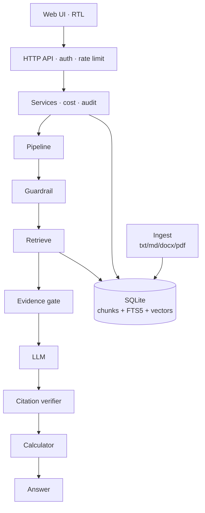

# بيّنة · Bayyinah

[](https://github.com/Hamza1010-coder/Bayyinah/actions/workflows/ci.yml)
[](LICENSE)

**Arabic-first compliance copilot for Saudi employment law. Every answer carries the article it came from — or it doesn't answer.**

> **Status:** v1.0, working end to end. 163 tests, 8 eval metrics gated in CI.
> The bundled corpus is **synthetic (8 articles)** — real-statute ingestion is the
> next step, and the import path is built and documented in [PROVENANCE.md](PROVENANCE.md).
> Read the numbers as mechanism measurements, not legal accuracy.

**Reviewing this?** Four files carry most of the signal —
[CASE_STUDY.md](docs/CASE_STUDY.md) (why it's built this way) ·
[verifier.py](bayyinah/generation/verifier.py) (the guarantee, in 60 lines) ·
[run_eval.py](evals/run_eval.py) (what gets measured) ·
[DEMO.md](docs/DEMO.md) (a recorded run).

Most RAG demos answer everything, cite nothing verifiable, and have no numbers. This one refuses when it lacks evidence, verifies every citation character-by-character against the source, computes money in deterministic code instead of asking a model, and ships with an eval harness that gates the build.

```bash
cd bayyinah
python -m bayyinah ingest corpora/raw     # build the index (SQLite)
python -m bayyinah serve                  # http://127.0.0.1:8080
python scripts/demo.py                    # exercise every endpoint (2nd terminal)
```

On Windows, double-click **`start.bat`** instead — it picks the right Python,
starts the server and opens the browser.

No virtualenv, no API key, no GPU, no network. The core is stdlib-only Python 3.10+.

---

## What it does

### 1. Ask — bilingual Q&A, citation-verified

```
> كم مكافأة نهاية الخدمة إذا استقلت بعد 3 سنوات براتب 6000 ريال؟

إذا ترك العامل العمل بمحض إرادته استحق من مكافأة نهاية الخدمة الثلث...

الاحتساب (art_84+art_85)
  المكافأة الأساسية (المادة ٨٤): 9,000.00 ر.س
  نسبة الاستحقاق عند الاستقالة (المادة ٨٥): 1/3
  المستحق: 3,000.00 SAR

المصادر
[1] المادة 85  «إذا ترك العامل العمل بمحض إرادته استحق...»
```

Three things happened that most demos don't do:

- the model **did not do arithmetic** — a unit-tested calculator did;
- the quote is a **verified substring** of the stored source (normalized for diacritics, not for truth);
- every article number named in the prose **must** appear in the citations, or the verifier flags it.

### 2. X-Ray — contract audit

Paste text or upload `.txt/.md/.docx/.pdf`. Get clause-level findings, each bound to an article, each with the business consequence and a suggested redline — plus a downloadable **HTML or Word report**.

```
⛔ البند 2 — فترة التجربة ستة أشهر            → المادة 53
⛔ البند 4 — التنازل عن مكافأة نهاية الخدمة    → المادة 84
⛔ البند 5 — 56 ساعة أسبوعياً                 → المادة 98
⛔ البند 6 — إجازة سنوية 15 يوماً               → المادة 109
⚠️ البند 7 — إنهاء دون إشعار                   → المادة 60
```

PII (national IDs, IBANs, phones, emails, salaries) is redacted **before** analysis and never leaves the process.

Sample output from this repo: [sample-contract-audit.docx](docs/samples/sample-contract-audit.docx) · [sample-contract-audit.html](docs/samples/sample-contract-audit.html) (generated from [sample-contract.txt](docs/samples/sample-contract.txt)).

### 3. Audit trail

Every question is logged with retrieval results, verification outcome, latency and cost. Contract analyses are stored with their findings. `/api/stats` reports refusal rate and unit cost.

---

## Current eval results

Run against the live SQLite corpus:

| Suite | Metric | Value | Gate |
|---|---|---|---|
| QA (20 items) | retrieval recall@5 | **1.000** | ≥ 0.80 |
| QA | MRR | **0.969** | ≥ 0.60 |
| QA | citation validity (hard) | **1.000** | = 1.00 |
| QA | refusal accuracy | **1.000** | ≥ 0.90 |
| QA | false refusal rate | **0.000** | ≤ 0.10 |
| Contract (12 clauses) | violation precision | **1.000** | ≥ 0.80 |
| Contract | violation recall | **1.000** | ≥ 0.80 |
| Contract | citation rate | **1.000** | ≥ 0.95 |

```bash
python evals/run_eval.py --fail-on-gate    # exits 1 on regression
```

> These numbers describe a **synthetic 8-article corpus**. They prove the harness works and the invariants hold (no unverified citations, no ungrounded answers). They do **not** prove legal accuracy. Scaling to the real corpus and 150+ items is the roadmap in [MVP.md](docs/MVP.md).

---

## Architecture



- **guardrail** — jurisdiction / unlawful-intent refusal, before retrieval can find something adjacent
- **retrieve** — hybrid: FTS5 BM25 + dense vectors, weighted RRF fusion, IDF-weighted rerank with a bigram phrase bonus
- **evidence gate** — refuses when overlap is low *or* when no matched term is distinctive enough to count as evidence
- **verify** — hard fail if the article doesn't exist or the quote isn't a verbatim substring; one repair pass; then downgrade to sources-only
- **calculate** — deterministic and unit-tested; the model may only restate the result

Full detail: [docs/ARCHITECTURE.md](docs/ARCHITECTURE.md).

---

## Layout

```
bayyinah/
├── bayyinah/
│   ├── text/          normalize (index vs verify), chunker, pii
│   ├── retrieval/     bm25, embeddings, fusion, corpus, expand
│   ├── ingest/        loaders (txt/md/docx/pdf/html), pipeline
│   ├── generation/    prompts, llm, verifier, pipeline, render
│   ├── contracts/     rules, analyzer (LLM), reports (docx/html/md)
│   ├── calc/          end-of-service, leave, notice
│   ├── guardrails/    refusal policy
│   ├── api/           stdlib server + RTL single-page app
│   ├── db.py          SQLite schema, FTS5, audit
│   ├── services.py    answer/contract services, cost, stats
│   └── cli.py         ingest / ask / serve / eval / stats / reset
├── corpora/raw/       synthetic fixture (see the warning)
├── evals/             gold sets, metrics, harness, committed reports
├── tests/             163 tests, stdlib unittest
└── docs/              architecture, api, deployment, operations
```

---

## Configure

Everything is environment-driven; see [.env.example](.env.example).

| Variable | Default | Purpose |
|---|---|---|
| `BAYYINAH_DB_PATH` | `var/bayyinah.db` | SQLite database |
| `BAYYINAH_API_KEY` | *(unset)* | when set, `/api/stats` and `/api/ingest` require `X-API-Key` |
| `BAYYINAH_RATE_LIMIT` | `60` | requests/minute per key or IP |
| `BAYYINAH_LLM_BASE_URL` | *(unset)* | any OpenAI-compatible endpoint (OpenAI, vLLM, Ollama, TGI, self-hosted ALLaM) |
| `BAYYINAH_LLM_MODEL` | `gpt-4o-mini` | model id for cost accounting and calls |
| `BAYYINAH_LLM_API_KEY` | *(unset)* | provider key |
| `BAYYINAH_MIN_EVIDENCE` | `0.25` | refusal threshold (content-token overlap) |
| `BAYYINAH_MIN_TERM_IDF` | `0.85` | a match only counts as evidence above this IDF |

Without an LLM configured, the **extractive baseline** answers by selecting verbatim sentences — it cannot hallucinate a quote, which makes it a useful retrieval probe and a safe default.

---

## Use a real corpus

`corpora/raw/labor_law_sample_SYNTHETIC.txt` is **synthetic**, written for engineering tests. It is not legal text and nobody should act on it.

The real statute is ~5 minutes away — save the official page, then:

```bash
python scripts/import_law.py saved.html --out corpora/raw/labor_law.txt
rm corpora/raw/*SYNTHETIC*
python -m bayyinah ingest corpora/raw
python evals/run_eval.py         # numbers will drop; that is the honest result
```

The importer strips amendment chrome, parses **word-numbered** headings (`المادة الثانية والعشرون`), and reports article count plus gaps — a correct import says *252 articles, first 1, last 252*. Record provenance in [PROVENANCE.md](PROVENANCE.md) before ingesting.

> Why this is manual: the statute is published one page per law, it is not a bulk-download source, and silently scraping legislation is how you ship a partial copy without noticing.

---

## Honest limitations

- **The shipped corpus is 8 synthetic articles.** The harness is the deliverable at this size, not the accuracy.
- **The dense retriever is a hashing baseline, not a semantic model.** `BgeM3Embedder` is a drop-in in `retrieval/embed.py`; until then, semantic paraphrase is weak, which is why query expansion exists.
- **PDF support needs `pip install pypdf`**, and Arabic PDFs usually need OCR first — the loader says so instead of returning mojibake.
- **The X-Ray rules cover four violation classes.** The LLM layer extends coverage but is off by default (no key configured).
- **Single-tenant, single-writer SQLite.** Fine to hundreds of thousands of chunks; see [docs/ARCHITECTURE.md](docs/ARCHITECTURE.md) for the Postgres path.
- **Not legal advice.** The product refuses disputes, forces escalation, and always emits a disclaimer.

## Docs

- [CASE_STUDY.md](docs/CASE_STUDY.md) — the portfolio write-up: problem, decisions, tradeoffs
- [INTERVIEW.md](docs/INTERVIEW.md) — the questions this repo invites, with answers
- [DEMO.md](docs/DEMO.md) — a recorded end-to-end run with real output
- [ARCHITECTURE.md](docs/ARCHITECTURE.md) — layers, schema, retrieval math, scaling
- [API.md](docs/API.md) — endpoints and examples
- [DEPLOYMENT.md](docs/DEPLOYMENT.md) — Docker, TLS, KSA residency, backups
- [OPERATIONS.md](docs/OPERATIONS.md) — runbook
- [DECISIONS.md](DECISIONS.md) — ADRs
- [failure-taxonomy.md](docs/failure-taxonomy.md) — the ten ways it fails and what was done
- [pdpl-mapping.md](docs/pdpl-mapping.md) — privacy controls
- [MVP.md](docs/MVP.md) — the original spec and 6-week plan
