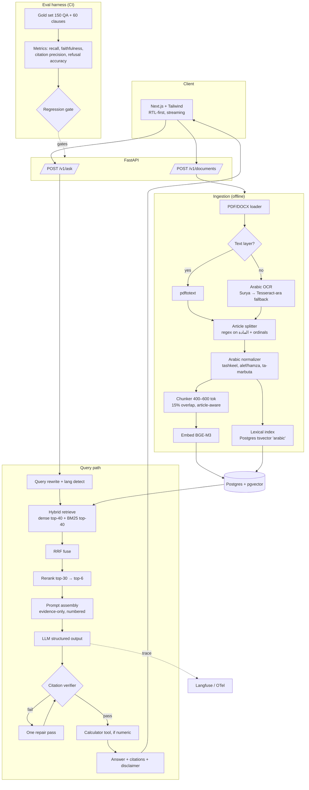

# Bayyinah — بيّنة

**A citation-grounded, Arabic-first compliance copilot for Saudi employment law.**

> *"Every answer carries the article it came from — or it doesn't answer."*

| | |
|---|---|
| **Status** | MVP spec, v1.0 |
| **Built for** | Landing an AI Engineer role in KSA (Riyadh / Jeddah / Dammam / NEOM) |
| **Build budget** | 6 weeks, one engineer, ~$120 in cloud + API spend |
| **Primary demo** | Upload an employment contract → get a clause-by-clause risk report with Labor Law citations |
| **Secondary surface** | Bilingual (AR/EN) Q&A over the Labor Law, its Implementing Regulations, and GOSI rules |

> **Implementation status:** v1.0 is built and running in this repository — see [`../README.md`](../README.md). SQLite-backed corpus (FTS5 + vectors), real ingestion (txt/md/docx/pdf), contract X-Ray with Word/HTML reports, auth + rate limiting + audit trail, 163 tests, both eval suites green. This document remains the v2 spec (real corpus, BGE-M3, multi-tenancy).

---

## 0. TL;DR — the 30-second pitch

Saudi SMEs get fined, sued, and stuck in Qiwa disputes because their HR teams don't know the Labor Law well enough. The knowledge is public, but it's 250+ articles of dense legal Arabic spread across a law, its implementing regulations, ministerial decisions, and GOSI circulars — and it changes.

**Bayyinah** answers HR compliance questions and audits employment contracts, in Arabic or English, and **every sentence it produces is traceable to a numbered article** — verified programmatically, not just promised in a prompt. If the corpus doesn't support an answer, it says so and escalates to a human.

It is not "ChatGPT for legal." It is a narrow, evaluable, auditable system with a refusal policy and a test suite that proves its accuracy. The engineering discipline is the product.

---

## 1. Why this project (the strategic read)

You are not building a startup. You are building **evidence** that you can do the job you're applying for. So the project has to survive the interview, not just the demo.

The Saudi AI hiring market has three dominant employer types, and each one grades you differently:

| Employer type | Examples | What their loop actually tests | How this project scores |
|---|---|---|---|
| **Government / national AI** | SDAIA, Saudi Center for AI, Elm, Thiqah, Takamol | Arabic NLP depth, data governance, PDPL, on-prem deployment, evaluation rigor | Arabic normalization + article-aware chunking + PDPL section + self-host path |
| **Enterprise / banking / energy** | Aramco, stc, Al Rajhi, SNB, SAB, Mobily, NEOM | RAG at scale, latency & cost, integration, security review, observability | Cost model, p95 latency targets, Langfuse tracing, NCA-style controls |
| **Consultancies & AI startups** | Accenture, Deloitte, PwC, QuantumBlack, HUMAIN-backed ventures | End-to-end ownership, client narrative, speed, measurable ROI | 6-week plan, demo script, ROI math, "what I cut and why" |

**Why employment law and not something flashier** (agents, video, robotics):

1. **It's Arabic-first by necessity, not by decoration.** Legacy RAG demos die here. Arabic morphology, diacritics, and right-to-left layout break naive pipelines — which is exactly the skill gap KSA employers complain about.
2. **It has a hard correctness bar.** Legal answers make hallucination a business risk, so the project *forces* you to build evals, citation verification, refusal logic, and guardrails. Recruiters can't tell a good RAG from a bad one — until you show them a failure taxonomy and a regression suite.
3. **The buyer is real and reachable.** Every SME in the Kingdom has this problem. You can get 5 user interviews in a week, which turns your README from "I built a thing" into "I shipped to users."
4. **It has a defensible wedge** that pure Q&A doesn't: contract *auditing* produces a document artifact with visible value, and it's the demo moment.

> **Anti-goal:** don't build a general legal chatbot. Narrow beats broad, and narrow is provable.

---

## 2. The problem

### 2.1 Jobs-to-be-done

| JTBD | Who | Current workaround | Cost of getting it wrong |
|---|---|---|---|
| "Can I put this person on a 6-month probation?" | HR generalist, 40-person company | WhatsApp a friend, or Google it in Arabic | Invalid probation → dispute at Qiwa → compensation |
| "Does this contract clause expose us?" | HR manager / GM | Pay a lawyer SAR 1,500 per contract, or sign it blind | Unenforceable clause, unpaid end-of-service liability |
| "What's the end-of-service payout if he resigns after 3 years?" | Finance / HR | Spreadsheet, guesswork, conflicting advice | Under-reserving by tens of thousands of SAR |
| "Is this termination procedure compliant?" | Owner | Ask the accountant | Labour court case, reputational damage |

### 2.2 Why the status quo fails

- **The knowledge is public but unusable.** The law is published as PDFs; there is no article-level, queryable, citable index in Arabic.
- **Generic LLMs answer confidently and wrongly.** Ask ChatGPT about Saudi probation periods and you'll get a plausible, uncited, sometimes-wrong answer with no way to check it.
- **Language asymmetry.** Most HR staff read Arabic more comfortably than English legalese; most AI tooling is English-first and translates as an afterthought.
- **No audit trail.** A compliance decision needs to show *why*. "The AI said so" is not a defense.

### 2.3 The one-sentence problem statement

> Saudi HR teams cannot quickly and confidently answer "does this comply?" — and the tools that could answer it are English-first, uncited, and unauditable.

---

## 3. Target user

**Primary persona — "Noura," HR Manager, 60-person contracting firm, Riyadh.**
Handles hiring, Qiwa, GOSI, and payroll admin alone. Reads Arabic natively, English adequately. Uses her phone more than a laptop. Has been burned by a labour dispute once and is now cautious. **Success for Noura:** a confident answer with the article number she can forward to her GM, in under a minute.

**Secondary persona — "Faisal," Compliance/HR consultant.**
Advises 8 SME clients. Bills by the hour. Needs speed and a document he can hand to a client with his logo on it. **Success for Faisal:** a contract risk report in 3 minutes that he can skim and correct.

**Tertiary persona — "the interviewer."**
Spends 15 minutes on your repo and 10 on your demo video. **Success:** sees evals, sees citations verified in code, sees a refusal, sees a cost table.

> **Design consequence:** every surface must work on a phone, must render Arabic properly (RTL, no broken ligatures), and must produce something forwardable (a PDF or a link) in one tap.

---

## 4. What it does

### 4.1 Mode A — Ask (RAG Q&A)

Bilingual question in, cited answer out.

**Input (Arabic, colloquial):**
> كم مكافأة نهاية الخدمة لو استقلت بعد ٣ سنوات؟

**Output:**

```text
الجواب:
إذا استقال العامل بعد ثلاث سنوات خدمة، يستحق مكافأة نهاية الخدمة بنسبة
ثلث المكافأة الكاملة وفقاً للمادة (٨٥) من نظام العمل — لأن نسبة الاستحقاق
تتدرج بحسب مدة الخدمة عند الاستقالة.

الاحتساب (وفق المادتين ٨٤ و٨٥):
• أول ٥ سنوات: نصف شهر عن كل سنة  →  ٣ × ٠.٥ = ١.٥ شهر
• الأجر الأخير: ٦,٠٠٠ ر.س
• المكافأة الكاملة: ٩,٠٠٠ ر.س
• نسبة الاستحقاق عند الاستقالة (سنتان – خمس سنوات): ١/٣
• المستحق: ٣,٠٠٠ ر.س

المصادر:
[1] نظام العمل، المادة ٨٤ — مكافأة نهاية الخدمة
[2] نظام العمل، المادة ٨٥ — الاستقالة
[3] اللائحة التنفيذية، المادة ٣٧ — طريقة الاحتساب

⚠️ هذه معلومات عامة وليست استشارة قانونية. للحالات النزاعية راجع محامياً مرخصاً.
```

Note what the system did: it **retrieved** the articles, it **called a deterministic calculator** for the money (the LLM did not do arithmetic), and it **rendered the arithmetic trace** so the user can check it.

### 4.2 Mode B — X-Ray (contract audit) ← the demo moment

Upload `عقد_عمل.pdf` (Arabic, English, or bilingual). Get back:

```text
عقد عمل — تحليل المخاطر                          التاريخ: ١١/١١/٢٠٢٦
─────────────────────────────────────────────────────────────────────
٣ مخالفات عالية الخطورة   ٢ متوسط   ٤ منخفض   ١١ بنداً سليماً

⛔ البند ٤ — فترة التجربة: ٦ أشهر
   المخالفة: المادة (٥٣) تحدد فترة التجربة بـ ٩٠ يوماً كحد أقصى.
   الأثر: الفترة الزائدة غير قابلة للتنفيذ؛ قد تُحتسب كفترة خدمة كاملة
          ويترتب عليها مستحقات.
   الاقتراح: استبدل "ستة أشهر" بـ "تسعون (٩٠) يوماً".

⛔ البند ٩ — التنازل عن مكافأة نهاية الخدمة
   المخالفة: لا يجوز الاتفاق على الإسقاط؛ الحق محكوم بالمواد ٨٤–٨٨.
   الأثر: الشرط باطل وقد يُعد دليلاً على سوء النية في نزاع.
   الاقتراح: احذف البند بالكامل.

⚠️ البند ١٢ — ساعات العمل: ٥٦ ساعة أسبوعياً
   المخالفة المحتملة: الحد النظامي ٤٨ ساعة (المادة ٩٨).
   ...
─────────────────────────────────────────────────────────────────────
تصدير PDF • إحالة إلى مستشار • تجاهل
```

Every finding carries: clause text → article → why it's a problem → business consequence → suggested replacement. That last column is what makes it usable rather than academic.

### 4.3 What the product *refuses* to do (by design)

| Request | Behavior |
|---|---|
| "What's the penalty for my competitor's violation?" | Refuse — outside corpus |
| "Draft a contract that avoids end-of-service pay" | Refuse — unlawful intent, logged |
| "My employee stole money, can I fire him without notice?" | Answer with the *procedure and evidentiary requirements* + cite articles + **hard escalate to a lawyer**, no verdict |
| A question about UAE or Egyptian labour law | Refuse, name the boundary |
| Nothing in the corpus supports it | "I don't have an article that covers this" — never a guess |

The refusal path is a **first-class feature**, not a fallback. It gets its own test set.

---

## 5. Scope: the cut lines

The hardest part of an MVP is the "out" column. This is what a senior engineer is judged on.

### ✅ In scope (v1)

- Bilingual AR/EN Q&A over a **closed corpus** (~500k tokens): Labor Law, Implementing Regulations, selected ministerial decisions, GOSI rules.
- **Hybrid retrieval** (dense + lexical) with article-aware chunking and a multilingual reranker.
- **Citation verifier**: every cited article must exist in the index *and* the quoted span must match a normalized substring of the source. Failing citations are dropped and the answer is regenerated once.
- **Deterministic calculator** for end-of-service awards, notice pay, and annual leave accrual — unit-tested, LLM never does the math.
- **Contract X-Ray** for PDF/DOCX up to 30 pages: clause segmentation → per-clause verdict (compliant / risky / non-compliant / not-covered) → citation → suggested redline.
- **PII redaction** on upload (names, national IDs, IBAN, salaries) before anything leaves the ingestion boundary.
- **Eval harness** with a 150-item gold set + 60-item contract set, gating CI.
- **Streaming chat UI**, RTL-correct, mobile-usable.
- **Audit log** per answer: question, retrieved doc IDs, model version, prompt hash, latency, cost.

### ❌ Explicitly out of scope (v1)

| Cut | Why | When it comes back |
|---|---|---|
| User accounts, multi-tenancy, billing | Zero learning value, pure overhead | v2 if you get real pilots |
| Fine-tuning an LLM | You don't have the data volume to beat RAG; it burns 2 weeks for a marginal gain | v3, after 2k real queries |
| Agentic multi-step workflows | Retrieval + verify + generate is a *deterministic pipeline*. Agents add failure modes with no upside here | v2 for the "gather documents from user" flow |
| Full document management (versions, folders, sharing) | Commodity | Never for an MVP |
| Arabic dialect speech input | Sexy, but not the bottleneck | v3 |
| Live scraping of Qiwa/GOSI | ToS + fragility | v2 via licensed/official API |
| ZATCA e-invoice compliance | Different domain, different corpus | Separate product |
| Coverage of all 250+ articles | Cover the top 60 by real-world frequency; measure coverage explicitly | Continuous |

> **Say this out loud in interviews:** "I cut fine-tuning because with 150 eval items I couldn't distinguish a fine-tune from noise, and RAG let me fix errors by editing the corpus instead of retraining." That sentence is worth more than any feature.

---

## 6. Architecture



**Deliberate choices**

- **One database.** Postgres + pgvector + `tsvector` means one backup story, one connection pool, one thing to host in-Kingdom. Qdrant/Elasticsearch buy you scale you don't have.
- **No LangChain.** A 400-line explicit pipeline is easier to debug, trace, and defend in a code review than a framework's abstraction stack. Say this in interviews.
- **Deterministic pipeline, not an agent.** Fixed stages, measurable per-stage latency, reproducible failures.
- **Structured output + verifier** beats prompt-engineering "please cite sources." Verification is code, not vibes.

---

## 7. Data & corpus

### 7.1 Sources

| Source | Approx. size | Access | Notes |
|---|---|---|---|
| نظام العمل (Labor Law) | ~250 articles | Public, Bureau of Experts (BOE) | The core. Arabic authoritative. |
| اللائحة التنفيذية (Implementing Regulations) | ~250 articles | Public, BOE | Explains *how* — many practical answers live here |
| Ministerial decisions (Saudization, work permits) | ~40 docs | Public, Ministry of HRSD | Volatile — date-stamp everything |
| GOSI rules & circulars | ~30 docs | Public | Pension/injury math |
| Curated HR FAQ (Qiwa public pages) | ~100 pages | Public web | Great for colloquial query coverage — check ToS, cache politely |

**Licensing note (put this in the README):** government legislation is public; do **not** scrape paywalled commentary or a commercial law firm's annotations. Keep a `PROVENANCE.md` with, per document: URL, retrieval date, issuing body, version, and any usage restriction. Recruiters at Elm and Thiqah *will* ask about this — most candidates have never thought about it.

### 7.2 Arabic normalization (this is where you win)

Run before both indexing and querying, symmetrically:

```python
import re, unicodedata

TASHKEEL = re.compile(r"[\u0617-\u061A\u064B-\u0652\u0670\u06D6-\u06ED]")

def normalize_ar(s: str) -> str:
    s = unicodedata.normalize("NFKC", s)
    s = TASHKEEL.sub("", s)            # strip diacritics
    s = re.sub(r"[إأآٱ]", "ا", s)      # unify alef
    s = s.replace("ى", "ي").replace("ؤ", "و").replace("ئ", "ي")
    s = s.replace("ة", "ه")            # ta marbuta (index side only)
    s = re.sub(r"\u0640+", "", s)       # tatweel
    s = re.sub(r"[^\w\s\u0600-\u06FF]", " ", s)
    return re.sub(r"\s+", " ", s).strip()
```

**Two gotchas most projects miss:**

1. **Asymmetric normalization.** Applying `ة→ه` to the *display* text corrupts legal quotes. Apply it to the **index/lexical** copy only; keep a `text_display` column untouched. The citation verifier compares against `text_display`.
2. **Arabic-Indic digits.** Users type `٩٠` and `90` interchangeably, and the law uses `(٩٠)`. Normalize digits to ASCII for retrieval, but preserve the original in quotes. Test both.

### 7.3 Chunking

Legal documents must be chunked **structurally**, not by fixed window:

```
Document → Chapter (الباب) → Article (المادة) → Paragraph
```

- Split on `المادة` + Arabic ordinal/number, plus `\n\s*(\d+)[-.)]` for English translations.
- Emit chunks of 400–600 tokens with 15% overlap, but **never cross an article boundary** unless the article exceeds 900 tokens (then split on paragraph, repeating the article ID in every chunk).
- Store: `doc_id, article_no, chapter, page, lang, text_display, text_norm, url, retrieved_at`.
- **Prepend context to every chunk before embedding**: `"نظام العمل — الباب الخامس — المادة ٨٤"`. This single trick measurably improves recall on "which article says…" queries.

### 7.4 Gold set construction (do this in week 1, not week 6)

| Slice | Count | How you build it |
|---|---|---|
| Answerable — easy (single article) | 45 | Write from the law directly |
| Answerable — multi-hop (2–3 articles) | 30 | Requires synthesis; hardest slice |
| Answerable — colloquial/Gulf phrasing | 15 | Ask 3 HR people to phrase things naturally |
| Unanswerable (not in corpus) | 30 | Deliberately adjacent topics |
| Adversarial (unlawful intent, out-of-scope jurisdiction) | 15 | Must refuse, not lecture |
| Contract clauses (risky / clean) | 60 | 40 annotated violations, 20 clean controls |
| **Total** | **195** | ~2 days of work |

Every item: `{id, lang, category, question, gold_answer, gold_articles[], answerable, difficulty}`. Two annotators where possible; record disagreements — **inter-annotator disagreement is a finding, not a bug.** Write it up.

> **If you skip this section, you have a demo. If you do it, you have a product.**

---

## 8. Model & stack decisions

| Layer | Choice | Alternatives considered | Why |
|---|---|---|---|
| **Embeddings** | `BGE-M3` (self-hosted) | Cohere multilingual v3, `text-embedding-3-large` | Multilingual, 8192 ctx, strong Arabic, no per-token cost, runs on one GPU |
| **Lexical** | Postgres `tsvector` + `pg_trgm` | OpenSearch Arabic analyzer | Zero extra infra; Arabic stemmer is mediocre but RRF fusion covers it |
| **Reranker** | `bge-reranker-v2-m3` | Cohere Rerank 3.5 | Cheap, multilingual, big precision win on legal text |
| **Generator** | `gpt-4o-mini` class as baseline | **ALLaM** (SDAIA), Gemini Flash, Claude Haiku | Baseline for cost/latency; **benchmark ALLaM on your Arabic gold set and report the comparison** — this is a Saudi-market differentiator |
| **OCR** | Surya → Tesseract-`ara` fallback | Azure Doc Intelligence, Google Document AI | Open, no residency problem; measure CER on 50 pages |
| **Orchestration** | Plain Python + FastAPI | LangChain, LlamaIndex | Debuggability, traceability, defensibility |
| **Vector store** | pgvector (HNSW) | Qdrant, Weaviate | One DB |
| **Tracing** | Langfuse (self-hosted) | Phoenix, LangSmith | Self-host = no data leaves the box; also a PDPL talking point |
| **UI** | Next.js + Tailwind + shadcn | Streamlit | Streamlit can't do RTL well and screams "prototype" |
| **Eval** | Custom harness + LLM-as-judge | RAGAS, DeepEval | You need claim-level citation metrics RAGAS doesn't give you |

### The ALLaM comparison (worth a week, worth a paragraph in every interview)

Run your 150-item gold set through both `gpt-4o-mini` and a self-hosted `ALLaM-7B-Instruct`. Report:

| Metric | GPT-4o-mini | ALLaM-7B | Δ |
|---|---|---|---|
| Answer faithfulness | | | |
| Citation precision | | | |
| Refusal accuracy | | | |
| Arabic fluency (1–5 judge) | | | |
| p95 latency | | | |
| Cost / 1k queries | | | |

**Why this matters commercially:** PDPL and NCA Cloud Controls make "in-Kingdom, self-hosted, no data egress" a procurement requirement for government and banking buyers. Being able to say *"the open Saudi model is within X points on my task at one-fifth the cost, and it never leaves the VPC"* is a genuine engineering judgment story, not a benchmark brag. Verify current model availability and licence terms at build time — the ecosystem moves monthly.

---

## 9. The answer contract

The LLM's job is to **select and quote**, never to originate facts or compute numbers.

```json
{
  "answer_ar": "string",
  "answer_en": "string",
  "citations": [
    {
      "doc_id": "labor_law_2005",
      "article_no": "84",
      "quote_ar": "…",
      "page": 37,
      "url": "https://…"
    }
  ],
  "calculations": [
    {
      "kind": "end_of_service",
      "inputs": {"salary": 6000, "years": 3, "reason": "resignation"},
      "result": 6000,
      "formula_ref": "art_84_85"
    }
  ],
  "confidence": "high | medium | low",
  "refusal": null,
  "risk_flags": ["financial_liability", "termination"],
  "requires_human_review": false,
  "disclaimer_required": true
}
```

### The verifier (the part that makes this credible)

```python
def verify_citations(answer, sources) -> VerificationResult:
    problems = []
    for c in answer.citations:
        doc = sources.get(c.doc_id, {}).get(c.article_no)
        if doc is None:
            problems.append(("article_not_found", c))       # hard fail
            continue
        if normalize_ar(c.quote_ar) not in normalize_ar(doc.text_display):
            problems.append(("quote_not_verbatim", c))       # hard fail
        if not supports_claim(c, doc):                        # judge, sampled
            problems.append(("quote_not_supporting", c))      # soft fail
    return VerificationResult(problems)
```

Hard fails trigger **one** regeneration with the failure reason injected. A second failure downgrades the answer to `confidence: low` and surfaces the sources without a synthesized answer. **Silence is a valid output; a confident wrong answer is not.**

### Numbers rule

```
if answer contains any monetary amount or duration:
    → extraction call returns structured params
    → deterministic calculator computes
    → calculator output is injected into the prompt as a fixed string
    → LLM may only restate it
```

Calculators are unit-tested against hand-computed cases from the Implementing Regulations, and **reviewed by a Saudi HR practitioner**. If you can't get a reviewer, restrict the calculator to end-of-service only and label it beta.

---

## 10. Evaluation

### 10.1 Metrics and targets

| Metric | Definition | Target (v1) | Gate |
|---|---|---|---|
| Retrieval recall@10 | Gold article in top-10 fused results | **≥ 0.90** | CI blocks |
| MRR | Mean reciprocal rank of gold article | **≥ 0.75** | CI blocks |
| Answer faithfulness | Claims supported by retrieved context | **≥ 0.90** | CI blocks |
| Citation precision | Cited articles that actually support the claim | **≥ 0.85** | CI blocks |
| Citation validity | Cited article IDs that exist (hard) | **1.00** | CI blocks |
| Refusal accuracy | Correct refusals on unanswerable/adversarial | **≥ 0.90** | CI blocks |
| False-refusal rate | Answerable questions wrongly refused | **≤ 0.08** | warn |
| AR/EN parity | \|score_ar − score_en\| | **≤ 5 pts** | warn |
| Contract clause F1 (violations) | Precision/recall on 60-item set | **≥ 0.80** | CI blocks |
| p95 end-to-end latency | Streamed complete answer | **≤ 6 s** | monitor |
| Cost per query | Model + rerank | **≤ $0.01** | monitor |

### 10.2 Harness shape

```
evals/
  gold/qa_gold.jsonl          # 150 items
  gold/contract_gold.jsonl    # 60 clauses
  gold/adversarial.jsonl      # 15 items
  run_eval.py                 # → evals/reports/YYYY-MM-DD.json
  metrics.py                  # recall, mrr, faithfulness, citation_precision, ...
  judge_prompts.md            # versioned, pinned model
  reports/                    # committed, diffable history
```

```bash
$ python evals/run_eval.py --slice all --model gpt-4o-mini
retrieval.recall@10        0.93   ✓
retrieval.mrr              0.79   ✓
answer.faithfulness        0.91   ✓
citation.precision         0.88   ✓
citation.validity          1.00   ✓
refusal.accuracy           0.92   ✓
refusal.false_refusal      0.06   ✓
contract.clause_f1         0.82   ✓
latency.p95_s              4.7    ✓
cost.usd_per_query         0.0089 ✓
──────────────────────────────────
GATE: PASS
```

**Commit the reports.** A `reports/` directory with 6 dated files showing scores going from 0.71 → 0.93 is the single most persuasive artifact in the whole repo. It proves you iterate on evidence.

### 10.3 Judge discipline

- Pin the judge model and prompt version; store both in every report.
- Judge on **claim-level** attribution, not vibes: extract claims, ask "is claim N entailed by the cited article *alone*?"
- Hand-label 30 items to estimate judge agreement with you. **Report it** ("judge agrees with human on 27/30"). An unreported judge is a liability.
- Judge in the same language as the answer, Arabic judge for Arabic answers.

---

## 11. Security, privacy, PDPL

This section is why an enterprise interviewer will take you seriously.

| Concern | Control |
|---|---|
| **Data residency** | Deploy everything in a KSA region (e.g., Oracle Jeddah/Riyadh, Google Dammam) or fully self-hosted on-prem. No cross-border transfer of personal data by default. |
| **PDPL** | Personal Data Protection Law (Royal Decree M/19, 2021; in force Sept 2023). Lawful basis, purpose limitation, retention, data-subject rights, breach notification. Document a short DPIA-style note. |
| **NCA controls** | Map to NCA Essential Cybersecurity Controls (ECC) and Cloud Cybersecurity Controls (CCC): encryption at rest/in transit, least privilege, logging, secure SDLC. Even a table mapping "control → how we meet it" is a massive differentiator. |
| **PII minimization** | Redact names, national IDs, IBANs, phone numbers, and salaries **at the ingestion boundary**, before storage and before any third-party call. Keep a `pii_map` in an encrypted column if you need to restore for display. |
| **Model provider terms** | If using a hosted API, confirm no-training-on-inputs and zero-retention are available; otherwise route contract analysis exclusively to the self-hosted path. |
| **Prompt injection** | Document text is untrusted. Never let extracted document content override system instructions; strip instruction-like patterns; keep the answer schema strict. |
| **Audit trail** | Immutable log: request ID, user, document hash, retrieved doc IDs, model+version, prompt hash, output, verification result. Needed for both compliance and debugging. |
| **Access** | Single-tenant, no cross-tenant retrieval. In v1, one deployment per customer is fine. |
| **Retention** | Raw uploads deleted after 30 days by default; derived findings retained; user-triggered deletion honored and logged. |

**Positioning guardrail:** the product must present itself as **general compliance information, not legal advice**, with a named escalation path. This is not a legal nicety — it's the difference between a product and a liability, and it's a designed behavior (`requires_human_review`, `disclaimer_required`) that you can demo.

---

## 12. Deployment & cost

### 12.1 Topology

```
┌──────────────── KSA region VPC ─────────────────┐
│  Next.js (Cloud Run / VM)                       │
│  FastAPI (2× 2 vCPU)                            │
│  Postgres 16 + pgvector (managed, encrypted)    │
│  GPU box (L4 / A10) — BGE-M3 + reranker,        │
│      optional ALLaM-7B                          │
│  Langfuse (self-hosted)                         │
└─────────────────────────────────────────────────┘
              │ (only if hosted LLM route)
              ▼
      LLM API (no retention, no training)
```

### 12.2 Cost model (monthly, 2,000 queries/day ≈ 60k)

| Item | Spec | USD/mo |
|---|---|---|
| GPU (L4, 24/7) | BGE-M3 + reranker, batch | 220 |
| Postgres managed (2 vCPU/8GB, 100GB) | | 120 |
| API compute (2 × 2 vCPU) | | 60 |
| Hosted LLM @ $0.0089/query | 60k queries | 534 |
| Storage + egress | | 30 |
| **Total (hosted LLM)** | | **≈ 964** |
| **Total (self-hosted ALLaM)** | bigger GPU box | **≈ 1,100** |

At SAR 15/user/mo with 100 users = SAR 1,500 (~$400) — *underwater*. At SAR 199/user/mo (a consultant-tier price) with 100 users = SAR 19,900 (~$5,300) — healthy.

**Say this in interviews:** "The unit economics only work in the consultant/enterprise tier, not SME self-serve. That's why the v1 go-to-market is consultancies, and why cost-per-query is a tracked metric from day one, not a post-launch surprise."

That paragraph does more for you than any model benchmark.

### 12.3 What you actually deploy for the demo

Cheapest credible path: single VM + Docker Compose (`postgres`, `api`, `web`, `gpu-worker` behind a queue), Caddy for TLS. **Do not** build Kubernetes for an MVP. Also run a **fully offline Docker Compose profile** (`make demo-offline`) so you can demo with no network — a very good look in a government interview.

---

## 13. Build plan (6 weeks, solo, part-time-friendly)

| Week | Goal | Deliverables | Definition of done |
|---|---|---|---|
| **0** (3 days) | Validate before building | 5 conversations with HR/consultants; 1-page memo; landing page capturing email | You can quote a real person's pain verbatim |
| **1** | Corpus + retrieval | 5 docs ingested, article splitter, normalizer, pgvector, hybrid search, `/search` debug endpoint | recall@10 ≥ 0.80 on 30 seed questions |
| **2** | Answer engine | Prompt + structured schema + citation verifier + refusal path + streaming API | 50-item gold set passing; zero uncited answers |
| **3** | Evals + hardening | Full 150-item set, contract set v1, judge calibration, CI gate, Langfuse traces | GATE: PASS committed; failure taxonomy written |
| **4** | Contract X-Ray | PDF ingest, OCR fallback, clause segmentation, findings schema, PDF export | Contract F1 ≥ 0.75; one real contract audited end-to-end |
| **5** | Product surface | Next.js UI (RTL), mobile, citation hover cards, disclaimer flow, audit log view | A non-technical person completes both flows unassisted |
| **6** | Ship + tell | Deployed in KSA region, README, 3-min demo video, blog post, 2 pilot users | Stranger can clone → `make dev` → working app in < 15 min |

**Hard rule:** week 3's gate must pass before you start week 4. If evals are red, you fix them. That discipline *is* the story.

### Milestone artifacts (what the repo shows)

```
M1  corpus + retrieval     →  notebooks/01_retrieval_analysis.ipynb
M2  answer engine          →  evals/reports/2026-11-18.json  (0.71 recall!)
M3  eval gate green        →  evals/reports/2026-11-25.json  (0.93 recall)
M4  contract X-Ray         →  docs/sample_report_ar.pdf
M5  UI + deploy            →  https://demo.bayyinah.sa (KSA region)
M6  narrative              →  README + video + post
```

---

## 14. Demo script (3 minutes, no slides)

| Time | Beat | What's on screen |
|---|---|---|
| 0:00–0:20 | **Hook** | "A Saudi HR manager just signed a contract with a 6-month probation clause. It's illegal. She doesn't know. Here's what happens when she runs it through Bayyinah." |
| 0:20–0:50 | **X-Ray fail case** | Upload Arabic PDF → finding appears → click citation → the article text opens, highlighted. "That highlight is verified in code, character by character." |
| 0:50–1:20 | **The hard part** | Ask a colloquial Arabic question with a number in it. Show the deterministic calculation block. "The model never touched the arithmetic." |
| 1:20–1:50 | **The refusal** | Ask about UAE labour law → clean refusal + boundary + escalation. "Most demos skip this. It's the feature." |
| 1:50–2:20 | **The evidence** | Cut to `evals/reports/` diff: "0.71 → 0.93 recall over four iterations. Here's the failure taxonomy that got me there." |
| 2:20–2:45 | **The engineering** | Architecture diagram + cost table + "runs entirely in-Kingdom, no data egress." |
| 2:45–3:00 | **Ask** | "I'm looking for an AI engineering role where Arabic-first and auditable matters. Here's the repo." |

**Rule:** lead with a failure the user doesn't know they have, not with your stack.

---

## 15. Risks & mitigations

| Risk | Likelihood | Impact | Mitigation |
|---|---|---|---|
| Legal text changes; answers go stale | High | High | Version + date every document; show "as of" on every answer; quarterly re-ingest job |
| Arabic OCR quality on scanned contracts | High | Medium | CER benchmark on 50 pages; surface "low text quality — please verify" banner; offer manual text paste |
| Hallucinated article numbers | Medium | **Severe** | Verifier hard-fails; 100% citation-validity gate; adversarial test set |
| Corpus licensing claim | Low | High | Only public legislation; `PROVENANCE.md`; no paywalled commentary |
| Users treat output as legal advice | High | High | Persistent disclaimer, escalation path, no definitive verdicts on disputes, refusal on unlawful intent |
| Scope creep into "general legal AI" | **Very high** | High | The out-of-scope table in §5 is a contract with yourself. Re-read it weekly |
| Eval set overfits (you wrote it, you pass it) | Medium | Medium | Hold out 20%, add colloquial phrasing from real users, report judge-human agreement |
| No users | Medium | High | Week 0 validation; recruit 2 pilot users before week 4 |
| You get bored in week 3 | Medium | Fatal | Ship the demo-able slice by end of week 4; everything after is polish |

**Kill criteria** (write these down, they signal maturity):
- If recall@10 < 0.75 after week 2 → the corpus/chunking is wrong; stop and fix before touching the prompt.
- If contract F1 < 0.6 after week 4 → narrow X-Ray to *clause detection only*, drop the suggested-redline feature.
- If you can't get one real user by week 5 → the problem isn't painful enough; pivot the vertical, keep the engine.

---

## 16. What most MVPs get wrong (the gap checklist)

This is the part people skip, and it's the part that gets you hired. Tick these off explicitly in your README.

| # | Gap | How Bayyinah closes it |
|---|---|---|
| 1 | **No evaluation** — "it looked good in the demo" | 195-item gold set, 10 metrics with numeric gates, CI-blocking, committed reports |
| 2 | **No refusal behavior** — answers everything | First-class refusal path with its own 45-item test slice and accuracy target |
| 3 | **Citations that aren't verified** — prompt says "cite sources" | Programmatic verifier: article exists + quote is a normalized substring |
| 4 | **LLM doing arithmetic** | Deterministic calculators, unit-tested, reviewer-checked |
| 5 | **Arabic as an afterthought** — translation layer on an English pipeline | Arabic normalization, article-aware chunking, Arabic-first prompts, AR/EN parity metric |
| 6 | **No cost or latency story** | p95 latency target, $/query tracked, monthly cost model, unit-economics paragraph |
| 7 | **No privacy story** | PII redaction at boundary, KSA residency, NCA control mapping, retention policy |
| 8 | **No observability** | Langfuse traces per stage, audit log per answer, prompt+model versioning |
| 9 | **No failure taxonomy** | A written doc of the 10 ways it fails and what you did about each |
| 10 | **No real users** | 5 interviews in week 0, 2 pilots by week 5, quotes in the README |
| 11 | **No "why not X"** | Documented cuts: no fine-tuning, no agents, no multi-tenancy — with reasons |
| 12 | **No narrative** | 3-min demo script, README first-screen, one blog post, one LinkedIn post |
| 13 | **Data provenance ignored** | `PROVENANCE.md` per document: source, date, issuer, licence |
| 14 | **Only the happy path works** | Error states: scanned PDF, 60-page doc, mixed AR/EN, empty retrieval, provider timeout |
| 15 | **No maintainability signal** | Tests, typed schemas, `make` targets, ADRs for the 5 big decisions |

### Failure taxonomy to write (week 3)

Document each with: example, root cause, fix, regression test added.

1. Retrieval miss — correct article exists, not retrieved (chunking or normalization)
2. Retrieval distractors — semantically similar article on a different topic
3. Quote drift — model paraphrases instead of quoting
4. Article confusion — cites 84 when it means 85 (adjacent-article trap)
5. Stale law — answer reflects repealed provision
6. Over-refusal — refuses a question the corpus *does* answer
7. Under-refusal — answers from world knowledge, not corpus
8. Numeric error — arithmetic slipped past the calculator guard
9. Language drift — Arabic question answered in English, or vice versa
10. Contract mis-segmentation — clause boundary wrong, verdict attached to wrong text

---

## 17. Success metrics (definition of done)

**Product**
- [ ] A stranger completes both flows on a phone, unassisted, in under 3 minutes.
- [ ] 5 real HR/consultant users have used it; 3 say they'd use it again.
- [ ] One real contract audited end-to-end, with the user confirming at least 2 findings they'd missed.

**Engineering**
- [ ] All 10 eval gates green, committed in `evals/reports/`.
- [ ] Zero answers containing an unverified citation (checked on the full gold set).
- [ ] p95 latency ≤ 6s; cost/query ≤ $0.01.
- [ ] `make dev` works from a clean clone in < 15 min on a fresh machine.
- [ ] Deployed in a KSA region; `make demo-offline` works with networking disabled.

**Career**
- [ ] 3-minute demo video with a hook, not a feature tour.
- [ ] README whose first screen makes a recruiter click "play".
- [ ] One blog post: "What I learned building a citation-verified Arabic RAG system" — with the numbers.
- [ ] You can answer, cold: *"What's your faithfulness score and how did you measure it?"*

---

## 18. Stretch (v2 / v3) — only after v1 ships

| Version | Feature | Why it's next |
|---|---|---|
| v2 | **Redline generator** — produce a corrected contract DOCX, track changes | Converts findings into billable work; huge for the consultant persona |
| v2 | **Multi-document compare** — firm policy vs. Labor Law gap analysis | Natural expansion, same engine |
| v2 | **Change monitoring** — diff the corpus monthly, alert on amended articles | Solves the staleness risk *and* becomes the retention hook |
| v2 | **Shareable audit link** — read-only report URL with expiry | Zero-friction distribution; makes "forwardable" real |
| v3 | **ALLaM fine-tune** on 2k curated Q/A pairs | Only after you have the data and the eval to prove it helps |
| v3 | **Voice input in Gulf dialect** | Real usage pattern (phone-first HR staff); needs ASR tuning |
| v3 | **Qiwa/GOSI integration** | Partner-dependent; becomes a platform play |
| v3 | **Second vertical reuse** — ZATCA e-invoicing compliance | Proves the engine generalizes; strong pitch material |

---

## 19. Career mapping — what each artifact buys you

| Artifact | Skill it proves | Interview question it answers |
|---|---|---|
| Article-aware chunker + Arabic normalizer | Arabic NLP, information retrieval | "How is Arabic different for retrieval?" |
| Hybrid search + RRF + reranker | Retrieval engineering, ranking | "Why not just vector search?" |
| Citation verifier | Grounding, hallucination control | "How do you stop it making things up?" |
| Deterministic calculators | Tool use, separation of concerns | "How do you handle numbers?" |
| 195-item gold set + 10 metrics + CI gate | Evaluation rigor (the #1 differentiator) | "How do you know it works?" |
| Refusal policy + adversarial set | Safety, product judgment | "What happens when it doesn't know?" |
| PDPL / NCA mapping + PII redaction | Governance, enterprise readiness | "Can we deploy this in our VPC?" |
| Cost model + latency targets | Production mindset | "What does this cost at scale?" |
| Langfuse traces + audit log | Observability | "How do you debug a bad answer?" |
| `PROVENANCE.md` + licensing notes | Professional maturity | "Where did the data come from?" |
| Out-of-scope table + kill criteria | Scoping judgment | "What did you cut and why?" |
| ALLaM vs GPT-4o-mini comparison | Model selection, local ecosystem | "Would you use a Saudi model?" |
| Demo video + README | Communication | "Walk me through it." |

**The 30-second interview answer:**

> "I built Bayyinah, an Arabic-first compliance copilot for Saudi employment law. The interesting part isn't the RAG — it's that I couldn't trust it, so I built a 195-item gold set, a citation verifier that checks quotes character-by-character against the source, and a deterministic calculator so the model never does arithmetic. I took faithfulness from 0.71 to 0.93 over four iterations, and I documented the ten ways it still fails. It runs entirely in-Kingdom because PDPL made data egress a procurement blocker."

That paragraph is the whole strategy.

---

## 20. Repo layout

```
bayyinah/
├── README.md                  # hook, demo gif, eval table, quickstart
├── MVP.md                     # this document
├── PROVENANCE.md              # per-document source, date, licence
├── DECISIONS.md               # 5 ADRs: pgvector, no-LangChain, no-finetune, ...
├── FAILURES.md                # failure taxonomy
├── Makefile                   # dev, ingest, eval, demo-offline, deploy
├── docker-compose.yml
├── apps/
│   ├── web/                   # Next.js, RTL-first
│   └── api/                   # FastAPI
│       ├── routers/           # ask.py, documents.py, health.py
│       ├── ingest/            # loader, ocr, splitter, normalizer, chunker
│       ├── retrieval/         # hybrid.py, rerank.py
│       ├── generation/        # prompt.py, schema.py, verifier.py
│       ├── calc/              # eos.py, leave.py, notice.py  (+ tests)
│       └── guardrails/        # pii.py, injection.py, refusal.py
├── corpora/
│   ├── raw/                   # PDFs + sha256 manifest
│   └── normalized/
├── evals/
│   ├── gold/*.jsonl
│   ├── run_eval.py
│   ├── metrics.py
│   └── reports/               # committed, dated
├── notebooks/                 # retrieval analysis, error analysis
└── docs/
    ├── architecture.md
    ├── pdpl-mapping.md
    ├── sample_report_ar.pdf
    └── demo-script.md
```

---

## 21. Appendix

### A. Glossary (use these terms correctly — it signals domain fluency)

| Arabic | Transliteration | English | Why it matters |
|---|---|---|---|
| نظام العمل | Niẓām al-ʿAmal | Labor Law | The core statute |
| اللائحة التنفيذية | al-Lāʾiḥa al-Tanfīdhiyya | Implementing Regulations | Where practical answers live |
| مكافأة نهاية الخدمة | Mukāfaʾat Nihāyat al-Khidma | End-of-service award | The #1 money question |
| فترة التجربة | Fatrat al-Tajriba | Probation period | Capped at 90 days (Art. 53) |
| التأمينات الاجتماعية | al-Taʾmīnāt al-Ijtimāʿiyya | GOSI / social insurance | Parallel obligation |
| قوى | Qiwa | Ministry HR platform | Where disputes surface |
| نطاقات | Niṭāqāt | Saudization bands | Compliance pressure driver |
| نظام حماية البيانات الشخصية | PDPL | Personal Data Protection Law | Residency + consent constraints |
| الهيئة السعودية للبيانات والذكاء الاصطناعي | SDAIA | Saudi Data & AI Authority | Regulator + ALLaM owner |
| مركز الذكاء الاصطناعي | SCAI | Saudi Center for AI | Standards, accreditation |

### B. Sample gold item

```json
{
  "id": "qa-017",
  "lang": "ar",
  "dialect": "saudi_colloquial",
  "category": "end_of_service",
  "question": "لو استقلت بعد ٣ سنوات كم آخذ؟",
  "gold_answer": "يستحق ثلث المكافأة الكاملة عند الاستقالة بعد خدمة تتراوح بين سنتين وخمس سنوات.",
  "gold_articles": ["84", "85"],
  "answerable": true,
  "difficulty": "medium",
  "must_include_calc": true,
  "notes": "Tests colloquial phrasing + numeric tool path"
}
```

### C. Sample contract finding

```json
{
  "clause_id": "c-004",
  "clause_text_ar": "تكون فترة التجربة ستة أشهر قابلة للتمديد.",
  "verdict": "non_compliant",
  "severity": "high",
  "article_no": "53",
  "rationale_ar": "المادة ٥٣ تحدد فترة التجربة بـ ٩٠ يوماً كحد أقصى.",
  "business_impact_ar": "الفترة الزائدة غير قابلة للتنفيذ وقد تُحتسب كخدمة فعلية.",
  "suggested_redline_ar": "تكون فترة التجربة تسعين (٩٠) يوماً غير قابلة للتمديد.",
  "confidence": 0.91
}
```

### D. Prompt skeleton (generation)

```text
أنت مساعد امتثال عمالي سعودي. مهمتك اختيار ونقل النصوص القانونية، لا تأليفها.

قواعد صارمة:
1. استخدم فقط المقاطع المرقّمة أدناه. لا تعتمد على معرفة خارجية.
2. كل عبارة قانونية يجب أن تُنسب إلى رقم المادة الذي وردت فيه.
3. لا تحسب أي مبلغ. استخدم نتيجة الأداة المرفقة كما هي.
4. إذا لم تجد سنداً واضحاً، قل ذلك صراحةً واقترح التصعيد.
5. أجب بنفس لغة السؤال.

المقاطع:
[1] المادة ٨٤ — …
[2] المادة ٨٥ — …

السؤال: {question}

أخرج JSON مطابقاً للمخطط المرفق فقط.
```

**Deliberately absent:** "be helpful," "be concise," personality. Legal retrieval prompts get worse when you add them.

### E. Open questions to resolve before week 1

- [ ] Which exact corpus version are you indexing? Pin the retrieval date.
- [ ] Do you have a Saudi HR practitioner willing to review 20 calculator outputs? If not, restrict scope.
- [ ] Hosted LLM or self-hosted from day one? (Affects the whole deployment story.)
- [ ] Is a KSA-region GPU instance actually available on your account, or do you need to plan around it?
- [ ] Who are the 5 people you'll call in week 0? Write the names down now.
- [ ] What's your one-line answer when someone asks "is this legal advice?"

---

## 22. The thing to remember

Anyone can build a RAG demo in a weekend. Almost nobody ships one that **knows when to shut up**, **proves its own citations**, and **shows its work with numbers**.

That's the gap. Build the gap.

---

*Bayyinah (بيّنة) — "clear evidence." Named for the thing the system refuses to answer without.*
